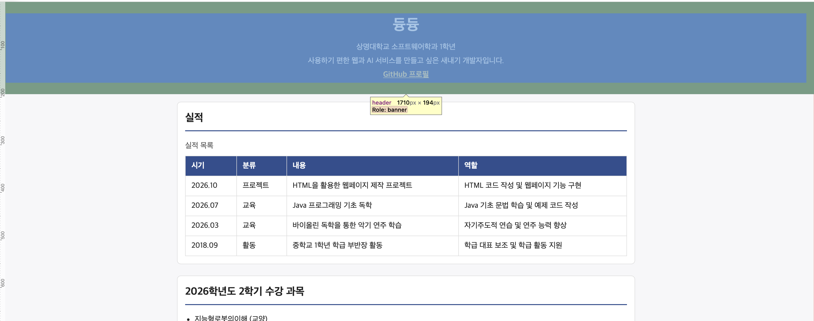
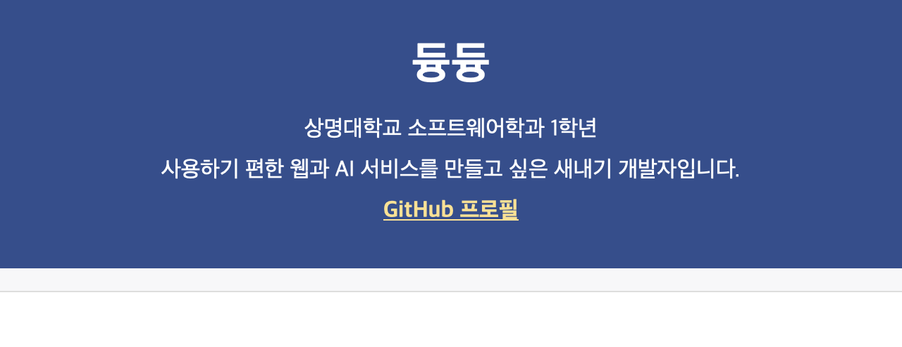
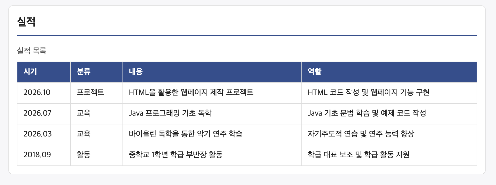
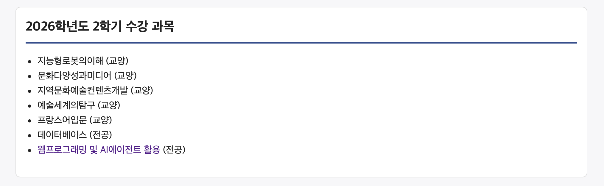
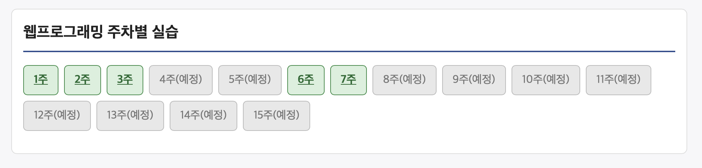

# 2026 웹프로그래밍 중간과제 - 개인 이력서 리포트

## 1. 인수 검수표
> 공지된 요구사항(F-01~F-06) 및 평가 기준(Q-HTML, Q-CSS, Q-DEPLOY)에 대해 직접 검수한 결과입니다.

| ID | 확인 방법 | 결과 | 근거 (증빙 스크린샷 및 설명) |
| :--- | :--- | :--- | :--- |
| **F-01** | 1280px 창에서 스크롤 없이 ①~④ 확인 | Fail |  *(1280px 화면에서 어떻게 작동하는지 확인 불가)* |

| **F-02** | GitHub 프로필 링크 1개 존재 및 타 연락처 부재 확인 | Pass |  *(하단 GitHub 링크 정상 이동, 타 연락처 미기재)* 
|
| **F-03** | 실적 4건 이상(고교 1건 포함), 역순 정렬, 표 형식 확인 | Pass |  *(총 5건 실적 역순 정렬 및 table 태그 적용)* |

| **F-04** | 2026-2 수강 과목 목록 및 F-05 이동 링크 확인 | Pass |  *(웹프로그래밍 과목 클릭 시 F-05 영역으로 이동)* |

| **F-05** | 1~15주차 표시, 진행 주차 링크 및 예정 주차 색상 구분 확인 | Pass |  *(1~7주차 링크 연결, 8주차 이후 예정 표시 및 색상 구분)* |

| **F-06** | footer에 `최종 수정일: YYYY-MM-DD` 표시 및 커밋일 일치 | Pass |  *(Git 커밋 날짜와 동일한 최종 수정일 확인)* |

| **Q-HTML** | W3C HTML 검사기로 배포 URL 검사 | Pass |  *(W3C HTML Validator 오류 0건)* |

| **Q-CSS** | W3C CSS 검사기로 외부 스타일시트 검사 | Pass |  *(W3C CSS Validator 오류 0건)* |

| **Q-DEPLOY**| 배포 URL 정상 동작 여부 및 깨진 링크/이미지 확인 | Pass | smu.ai.kr 배포 웹사이트 정상 접속 및 링크 작동 |

---

## 2. 완성도 분석

### ① 완성도 계산
* **충족한 요구사항 수**: 9개 (평가 대상 요구사항 9개 중 9개 충족)
* **총 평가 대상 요구사항 수**: 9개
* **최종 완성도**: 100% ( 9 / 9 )

### ② 구현 과정에서의 어려움 및 원인 분석
* **이슈 내용**: 초기 구현 시 모바일 화면이나 특정 창 크기에서 F-01 영역이 스크롤 없이 한 화면에 들어오지 않는 문제가 발생함.
* **원인**: 상단 header 부분의 여백(padding)과 폰트 크기가 너무 크게 설정되어 있었기 때문임. AI 에이전트를 활용해 레이아웃 구조를 검토하고 CSS 미디어쿼리와 Flexbox 정렬을 수정하여 해결함.

### ③ 다음 프로젝트에서 개선할 점
* 이번 과제에서는 기본 요구사항을 충족하는 데 집중했으나, 다음 프로젝트에서는 반응형 디자인을 더 정교하게 다듬어 다양한 디바이스 환경에서 완벽하게 시각적 일관성을 유지하도록 개선할 것임.